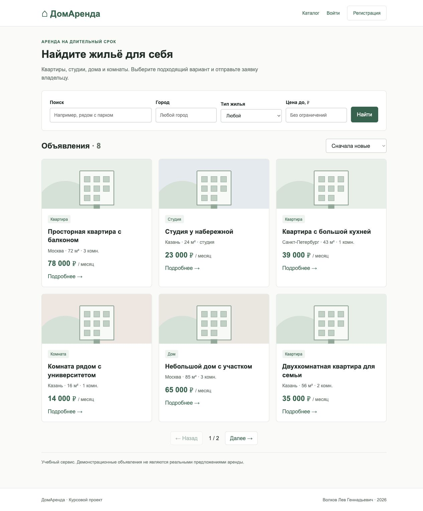

# ДомАренда

Курсовая работа **Волкова Льва Геннадьевича** на тему «Разработка веб-сервиса аренды недвижимости».

Простой учебный сервис для долгосрочной аренды: каталог, объявления собственников и заявки арендаторов. Стек: **Python 3.14, FastAPI, SQLite, HTML/CSS/JavaScript**. Фронтенд не требует Node.js и сборки.



## Быстрый запуск

Требуется Python **3.14** (на Windows вместо `python3` используйте `py -3.14`).

```bash
git clone https://github.com/unw1b3s/rent-home-coursework.git
cd rent-home-coursework
python3 -m venv .venv
source .venv/bin/activate
# Windows PowerShell: .venv\Scripts\Activate.ps1
python -m pip install -r requirements.txt
python -m app.seed
python -m uvicorn app.main:app --host 127.0.0.1 --port 8000
```

Открыть **http://127.0.0.1:8000**. Swagger: **http://127.0.0.1:8000/docs**. При первом запуске схема БД создаётся автоматически. Seed запускается отдельно, повторный запуск сохраняет существующие данные. Без seed приложение работает с пустой базой, пользователи создаются через регистрацию.

| Аккаунт | Email | Пароль |
| --- | --- | --- |
| Администратор | admin@example.com | demo12345 |
| Владелец восьми объявлений | owner@example.com | demo12345 |
| Арендатор | tenant@example.com | demo12345 |

Это только учебные аккаунты и вымышленные объявления. Для сервера с реальными пользователями не добавляйте демонстрационные аккаунты. Создайте своего пользователя через регистрацию и назначьте ему роль администратора локальной командой SQL, как описано в [руководстве](docs/SETUP.md).

## Возможности

- Гость: каталог, карточка объекта, поиск по тексту, фильтры по городу, типу и цене, сортировка и страницы по 6 объектов.
- Пользователь: регистрация, вход/выход, CRUD своих объявлений, отправка и отмена заявок, рассмотрение заявок на свои объекты.
- Администратор: статистика, просмотр и редактирование любых объявлений, удаление объявлений, блокировка и разблокировка пользователей.
- Принятие заявки переводит объект в «сдано» и отклоняет остальные ожидающие заявки одной транзакцией. Заявка не является договором аренды; оплата и юридическое оформление находятся вне проекта.

## Документация

- [Пояснительная записка Word](docs/coursework-report.docx) и [её редактируемый текст](docs/report.md).
- [Техническое задание](docs/TECHNICAL_SPEC.md).
- [Архитектура и схема БД](docs/ARCHITECTURE.md), [ER-диаграмма](docs/er-diagram.png), [исходник draw.io](docs/er-diagram.drawio).
- [API и примеры запросов](docs/API.md), [OpenAPI JSON](docs/openapi.json).
- [Запуск и сервер](docs/SETUP.md), [тестирование](docs/TESTING.md), [результаты](docs/test-results.txt).
- [План защиты и ответы на вопросы](docs/DEFENSE.md), [соответствие требованиям](docs/REQUIREMENTS.md).
- [Прототипы экранов](docs/prototypes.png), [скриншоты](docs/screenshots).

## Тесты

```bash
python -m pip install -r requirements-dev.txt
coverage run --source=app -m pytest -q
coverage report
# При запущенном сервере:
python scripts/benchmark.py
```

Проверка 20.10.2026: **24 теста прошли**, покрытие — **99%** (строки Python, включая seed; покрытие JavaScript не измерялось). Изолированные временные БД тестов не меняют рабочие данные. Подробности и ограничения измерений приведены в документации.

## Docker

```bash
docker compose up --build -d
docker compose exec web python -m app.seed
```

Открыть http://localhost:8000. База сохраняется в томе `rent-data`. Команда `docker compose down` сохраняет том. Docker-образ собран, контейнер запущен. Через HTTP проверены регистрация, вход, CRUD, запрет изменения чужого объекта и принятие заявки. После перезапуска контейнера seed-данные сохранились в томе. Результаты: [docker-results.txt](docs/docker-results.txt).

## Структура

```text
app/          сервер, модели запросов, безопасность, подключение к БД, seed
static/       HTML, CSS, JavaScript
sql/          миграция и тестовые записи
scripts/      измерение отклика и сборка отчёта
tests/        модульные и интеграционные проверки
docs/         пояснительная записка, API, схемы, скриншоты
deploy/       пример Nginx для HTTPS
```

В титульном листе оставлены поля для вуза, группы, преподавателя и города. Отдельная методичка вуза не предоставлена: отчёт оформлен на A4 шрифтом Times New Roman 14 пт, с интервалом 1,5; перед сдачей эти параметры нужно сверить с методичкой.

Для пересборки Word установите requirements-report.txt и выполните `python scripts/build_report.py`. Текст редактируется в docs/report-template.md; после изменений номера страниц в docs/report-pages.json нужно сверить с итоговым документом.
