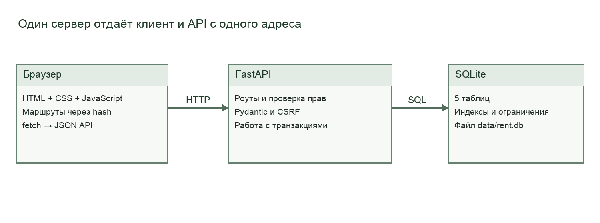
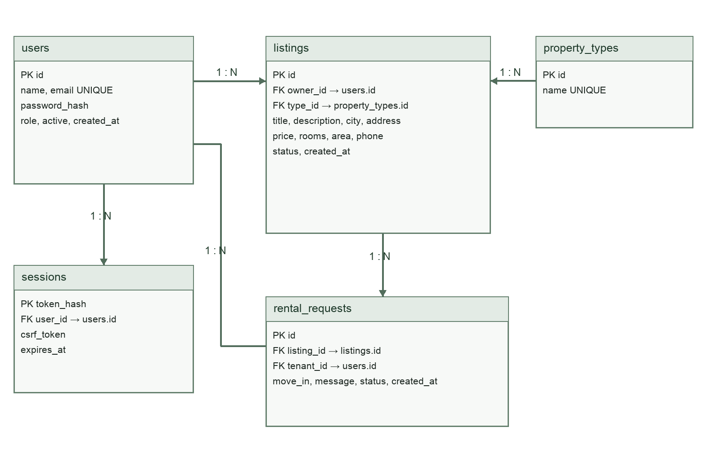
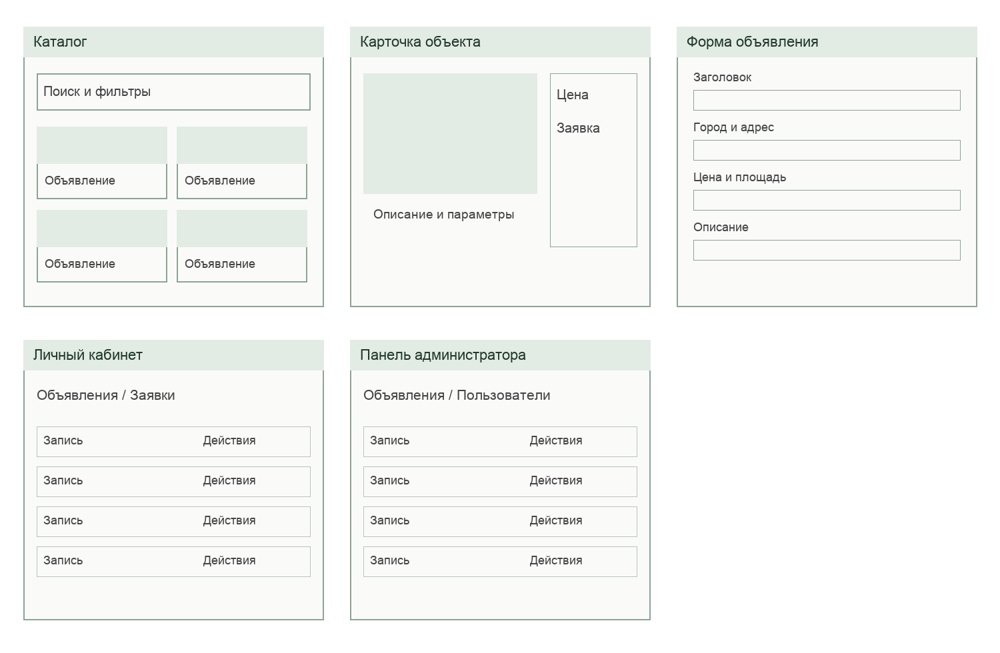
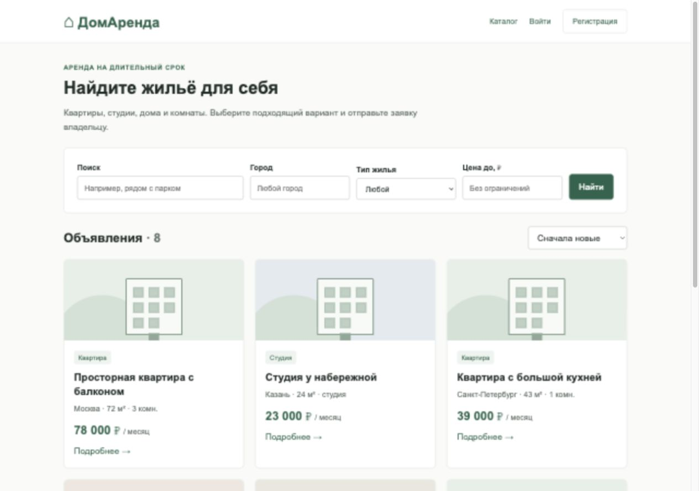
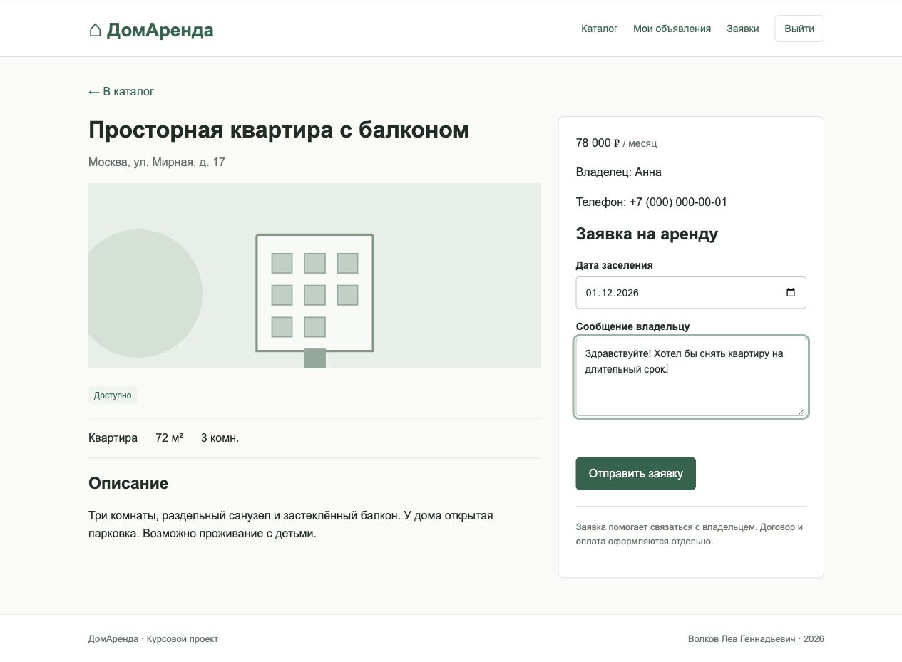
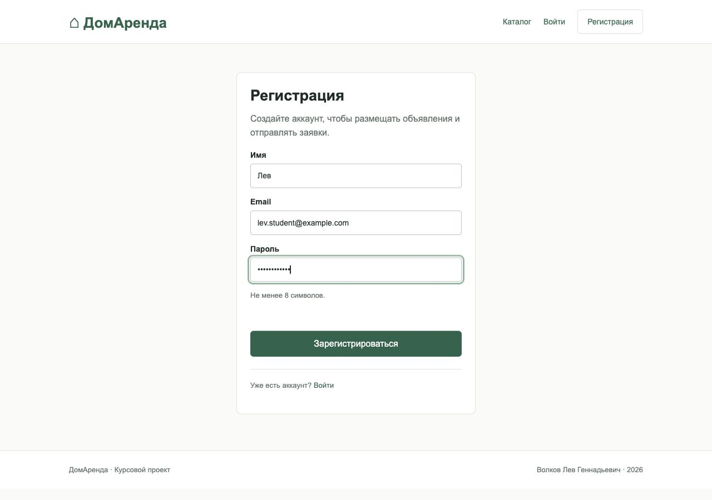
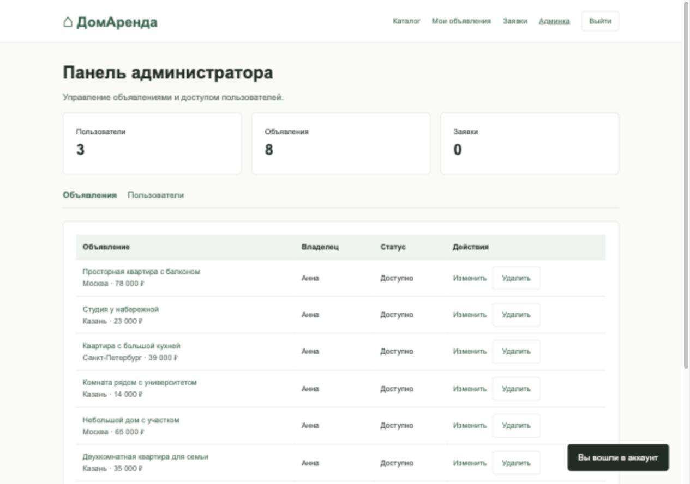
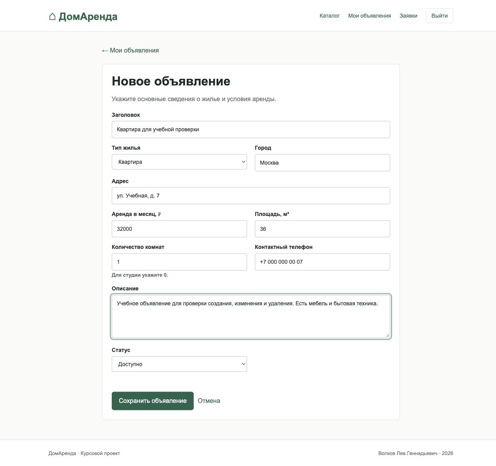

# Разработка веб сервиса аренды недвижимости

КУРСОВАЯ РАБОТА

Образовательная организация: ______________________________

Факультет или отделение: __________________________________

Кафедра: _________________________________________________

Дисциплина: Веб разработка

Тема: Разработка веб-сервиса аренды недвижимости

Выполнил: Волков Лев Геннадьевич

Группа: __________________

Проверил: ________________________________________________

Город: __________________

2026

<!-- page -->
# Задание на курсовую работу

Студент: Волков Лев Геннадьевич. Тема работы: «Разработка веб-сервиса аренды недвижимости». Основание для разработки — задание по курсу веб-разработки и опубликованная инструкция преподавателя [1].

Необходимо создать приложение, в котором владелец размещает сведения о недвижимости, а арендатор просматривает каталог и отправляет заявку на подходящий объект. Пользователь должен видеть результат своих действий: созданное объявление, изменённую цену или текущий статус заявки. Администратор должен иметь возможность управлять объявлениями и ограничивать доступ нарушителей.

Работа включает анализ, ТЗ, проектирование БД и API, прототипы, реализацию и тестирование. Требуются внешние ключи, индексы и ограничения данных, а также отдельное описание OpenAPI.

Результат работы — исходный код в GitHub, инструкция установки, SQL-миграция, демонстрационные данные, тесты и пояснительная записка. Записка должна содержать схему БД, описание API, ключевые фрагменты кода и скриншоты работающего приложения. В тестировании требуется отделять фактически проверенные сценарии от подготовленных, но не выполненных способов развёртывания.

Для проекта выбран небольшой объём: долгосрочная аренда квартир, студий, домов и комнат. Оплата, оформление договора, проверка документов собственника и расчёт коммунальных платежей не входят в функции приложения. Все начальные записи являются учебными примерами.

Срок сдачи по инструкции — 10 декабря первого семестра. Результаты проверки приведены в разделе 7, скриншоты — в docs/screenshots.

Дата выдачи: __________________   Подпись руководителя: __________________

<!-- page -->
# Содержание

{{CONTENTS}}

<!-- page -->
# Введение

При поиске жилья арендатору приходится сравнивать объявления по цене, расположению и основным характеристикам. Владельцу нужно хранить описание объекта, поддерживать актуальную стоимость и отвечать заинтересованным людям. Если сведения и обращения находятся в разных местах, сложнее понять, какое жильё ещё доступно и какие заявки ожидают ответа.

В работе разработан учебный веб-сервис «ДомАренда», который объединяет каталог недвижимости и простую обработку заявок. Объект исследования — размещение предложений о долгосрочной аренде. Предмет исследования — программные средства для хранения объявлений, поиска и управления обращениями пользователей.

Цель работы — создать запускаемое веб-приложение, позволяющее владельцам публиковать жильё, а арендаторам находить подходящие варианты и отправлять заявки. Для достижения цели нужно определить роли, спроектировать реляционную базу данных, реализовать REST API и связать его с браузерным интерфейсом. Отдельные задачи — защита учётных записей, проверка прав и тестирование критических операций.

Для реализации использованы Python, FastAPI, SQLite и чистый JavaScript. Такой стек позволяет показать клиент-серверное взаимодействие без сложной инфраструктуры. Пользователь открывает сайт в браузере, сервер обрабатывает запросы и сохраняет сведения в локальном файле БД. Для работы интерфейса не требуется сборка через Node.js.

Практический результат — приложение с каталогом, кабинетом, формами, заявками и админкой. Инструкция и учебные аккаунты позволяют повторить установку и проверку. Для реальных данных потребуется отдельная настройка сервера и дополнительная проверка безопасности.

<!-- page -->
# 1 Анализ предметной области
## 1 1 Пользователи и основные понятия

В сервисе рассматривается долгосрочная аренда. Объявление описывает один объект недвижимости, стоимость за месяц и контакт владельца. Объект может быть доступен или сдан. В объявлении нет интервалов бронирования и календаря занятости: после принятия заявки объект считается сданным до повторной публикации владельцем.

Арендатор ищет жильё по условиям, которые может оценить без обращения к владельцу: город, тип объекта, цена, площадь и количество комнат. Подробное описание помогает уточнить мебель, технику и условия проживания. После входа арендатор видит телефон и может оставить заявку с желаемой датой заселения и сообщением.

Владелец создаёт и изменяет объявления, рассматривает поступившие заявки. Это не отдельная роль в таблице пользователей. Один человек может сдавать собственный объект и одновременно искать жильё для себя. Поэтому права владельца определяются значением owner_id конкретного объявления, а не глобальным признаком аккаунта.

Администратор отвечает за содержимое каталога и доступ пользователей. Он может удалить неподходящее объявление, исправить его и заблокировать аккаунт. Заблокированный пользователь не может входить, а его предложения перестают показываться в публичном каталоге. При этом записи остаются в БД, что позволяет восстановить доступ без потери объявлений.

| Понятие | Содержание в проекте |
| --- | --- |
| Объявление | Характеристики объекта и условия аренды |
| Заявка | Обращение арендатора к владельцу |
| Сессия | Временное подтверждение входа в аккаунт |
| Модерация | Управление объявлениями и доступом |

Основной результат взаимодействия — согласованная заявка и изменение доступности объекта. Заключение договора выполняется вне сервиса; приложение не подтверждает право собственности и не проводит платежи.

<!-- page -->
## 1 2 Процесс размещения и аренды

Работа владельца начинается с регистрации. После входа он открывает форму объявления и заполняет обязательные поля. Сервер проверяет ограничения и записывает объект вместе с идентификатором текущего пользователя. Владелец не передаёт owner_id самостоятельно, поэтому не может создать запись от чужого имени.

Каталог показывает только доступное жильё активных пользователей. Арендатор вводит текст поиска, выбирает город и верхнюю цену. После применения фильтров сервер возвращает подходящие записи и их общее число. Пользователь открывает карточку, уточняет сведения и отправляет заявку.

У новой заявки статус pending. Владелец может принять или отклонить её. Арендатор может отменить только своё ожидающее обращение. После окончательного решения статус не редактируется повторно. Такая схема сокращает число переходов и делает поведение понятным при защите работы.

| Исходный статус | Действие | Результат | Кто выполняет |
| --- | --- | --- | --- |
| Нет заявки | Отправить | pending | Арендатор |
| pending | Принять | accepted | Владелец |
| pending | Отклонить | rejected | Владелец |
| pending | Отменить | cancelled | Автор заявки |

При принятии заявки сервер также изменяет объявление на rented и отклоняет другие ожидающие обращения на этот объект. Эти действия входят в одну транзакцию. Поэтому не возникает состояния, когда заявка уже принята, а объект ещё виден как свободный.

Владелец может вернуть объект в доступные через форму редактирования. Прежняя принятая заявка тогда переводится в cancelled. В учебной модели это завершение связи с прошлым арендатором, без ведения истории договоров. При удалении объявления связанные заявки удаляются каскадно. Перед этим интерфейс запрашивает подтверждение.

<!-- page -->
## 1 3 Выбор объёма и способа реализации

Для решения задачи можно использовать готовую доску объявлений, универсальную CMS или собственное веб-приложение. Готовый сервис удобен для обычного размещения жилья, однако не позволяет показать устройство своей БД и серверной проверки прав. CMS даёт готовые формы и управление содержимым, но добавляет настройки и расширения, не относящиеся к выбранной учебной задаче.

Собственное приложение позволяет связать требования с конкретными таблицами, маршрутами API и тестами. В проекте реализованы только функции, необходимые для полного сценария: публикация, поиск, обращение и решение владельца. Отдельные сервисы изображений, геокодирования, оплаты и рассылок не используются.

| Подход | Преимущество | Ограничение для курсовой |
| --- | --- | --- |
| Готовая площадка | Можно быстро разместить жильё | Нельзя показать собственную реализацию |
| CMS с расширениями | Есть готовая панель управления | Больше зависимостей и настроек |
| Собственное приложение | Видны API, БД и проверки | Нужно реализовать основные функции |

На клиенте выбран обычный JavaScript. Для пяти основных экранов достаточно маршрутов после символа # и функции перерисовки. Фреймворк мог бы облегчить развитие большого интерфейса, но в данном объёме добавил бы сборку и дополнительные понятия. Стили написаны в одном CSS-файле, изображения объектов заменены нейтральными рисунками из CSS.

На сервере выбран FastAPI: входные модели проверяются Pydantic, а список маршрутов доступен в OpenAPI [2]. SQLite хранит данные в одном файле и поддерживает необходимые связи и транзакции [3]. Такое решение позволяет запустить работу на обычном компьютере. При росте числа пользователей можно перенести данные в PostgreSQL, сохранив общий контракт API, но SQL и миграции потребуется адаптировать.

<!-- page -->
# 2 Техническое задание
## 2 1 Цель и функциональные требования

Разрабатываю веб-приложение для размещения и поиска объявлений о долгосрочной аренде недвижимости, чтобы пользователи могли находить жильё и обращаться к владельцам через заявки. Основные пользователи — арендаторы, владельцы недвижимости и администратор.

Функциональные требования определяют действия, которые можно проверить через интерфейс или HTTP-запрос. Для каждого действия есть серверный обработчик и понятный результат: новая запись, обновлённые данные, список либо сообщение об ошибке. Ниже приведена сокращённая матрица; полное ТЗ находится в docs/TECHNICAL_SPEC.md.

| Функция | Описание | Приоритет | Статус |
| --- | --- | --- | --- |
| Регистрация | Имя, email и пароль | Высокий | Готово |
| Авторизация | Вход, получение сессии, выход | Высокий | Готово |
| Каталог | Доступные объявления | Высокий | Готово |
| Поиск | Заголовок и описание | Высокий | Готово |
| Фильтры | Город, тип и максимальная цена | Высокий | Готово |
| Сортировка | Новизна и стоимость | Средний | Готово |
| Пагинация | По 6 записей в каталоге | Средний | Готово |
| CRUD | Управление объявлениями | Высокий | Готово |
| Заявки | Создание и решение владельца | Высокий | Готово |
| Админка | Объявления, пользователи, статистика | Высокий | Готово |

Пользователь должен получать сообщение при неверных данных и конфликте действий. Например, повторный email приводит к ответу 409, а попытка изменить чужое объявление — к 403. Успешное сохранение сопровождается переходом в кабинет и уведомлением.

Город фильтруется по полному названию, а текстовый поиск работает по подстроке. Это ограничение отражено в документации: поле города не является поиском по карте или радиусу. Данные каталога берутся с сервера при каждом изменении фильтров.

<!-- page -->
## 2 2 Роли и сценарии использования

Гость не имеет подтверждённой сессии. Он видит каталог и подробности объекта, но не получает телефон из публичного JSON-ответа. После регистрации или входа сервер возвращает сведения о пользователе и устанавливает cookie. С этого момента доступны операции с объявлениями и заявками.

| Операция | Гость | Пользователь | Администратор |
| --- | --- | --- | --- |
| Каталог и карточка | Да | Да | Да |
| Телефон владельца | Нет | Да | Да |
| Создание объявления | Нет | Да | Да |
| Изменение и удаление | Нет | Свои | Все |
| Отправка заявки | Нет | На чужие объекты | На чужие объекты |
| Решение по заявке | Нет | На свои объекты | На свои объекты |
| Блокировка аккаунта | Нет | Нет | Да |

Сценарий регистрации: пользователь вводит имя, email и пароль. Если данные проходят валидацию, создаётся аккаунт с ролью user и сессия на 24 часа. При занятом email форма сохраняется на экране и показывает ошибку. Роль администратора через форму регистрации выбрать нельзя.

Сценарий управления объявлением: владелец открывает личный кабинет, создаёт карточку, проверяет её в каталоге, затем меняет цену. При удалении появляется окно подтверждения. Сервер на каждом изменении повторно проверяет владельца, независимо от того, какие кнопки показаны в браузере.

Сценарий заявки: арендатор выбирает объект, указывает дату не раньше текущей и отправляет сообщение. Владелец видит обращение в разделе входящих заявок. После принятия арендатор видит accepted, а объект скрывается из доступного каталога. Две активные заявки одного автора на один объект не допускаются.

Сценарий администрирования: администратор открывает таблицу пользователей и блокирует обычный аккаунт. Сервер удаляет его сессии. Собственный или другой административный аккаунт блокировать нельзя, чтобы не потерять управление приложением.

<!-- page -->
## 2 3 Нефункциональные требования и ограничения

Интерфейс должен оставаться пригодным для работы на компьютере, планшете и телефоне. Для этого используются гибкая сетка карточек, перенос меню и перестроение формы. Основные поля имеют текстовые подписи, элементы управления доступны с клавиатуры, состояние фокуса выделяется рамкой. Соответствие конкретному стандарту доступности отдельно не сертифицировалось.

Целевое время ответа каталога в локальной учебной среде — p95 менее 500 мс. Измерение выполняется на небольшом наборе данных и не означает поддержку большого числа одновременных пользователей. Для публичного сервера требуется повторный замер с реальной сетью и конкурентными запросами.

Безопасность включает хеширование паролей, проверку полномочий на сервере, параметризованный SQL, защиту изменяющих запросов от CSRF и экранирование строк при выводе HTML. Cookie имеет HttpOnly и SameSite=Lax. Для внешнего HTTPS-развёртывания предусмотрен флаг COOKIE_SECURE=1; при локальном HTTP он отключён.

| Ограничение | Принятое решение |
| --- | --- |
| Небольшой учебный проект | Один сервер и одна БД |
| Простая установка | Без внешних API и сборки фронтенда |
| Долгосрочная аренда | Один доступный объект и заявки |
| Нет реальных платежей | Согласование через контакт и заявку |
| Нет загрузки фото | Нейтральная иллюстрация CSS |
| Неизвестна методичка вуза | Обычное оформление пояснительной записки |

SQLite подходит для демонстрации и небольшой нагрузки, но сериализует записи. Приложение запускается одним процессом; счётчик неудачных входов хранится в его памяти. Для нескольких экземпляров нужен общий ограничитель запросов. Docker-сборка и HTTP-сценарии в Linux-контейнере проверены. Публичный хостинг с доменом и HTTPS в рамках подготовки не настраивался.

<!-- page -->
# 3 Проектирование приложения
## 3 1 Архитектура и структура проекта

Клиент и API обслуживаются одним FastAPI-приложением. Браузер получает index.html, CSS и JavaScript, затем запрашивает JSON через fetch. Сервер проверяет запрос, выполняет SQL и формирует ответ. БД не доступна клиенту напрямую. Общая схема приведена на рисунке 1.



Серверная часть разделена на небольшие модули. main.py содержит маршруты и повторяемые проверки прав, schemas.py — модели входных данных, security.py — работу с паролями и токенами. db.py создаёт подключение, включает внешние ключи и закрывает ресурс после транзакции. seed.py добавляет только учебные записи.

Для проекта такого размера не введён отдельный класс репозитория для каждой таблицы. Повторяющиеся действия выделены в функции listing_by_id и check_owner. SQL остаётся виден рядом с обработчиком, что облегчает объяснение запросов при защите. Если приложение будет расширяться, бизнес-логику заявок можно выделить в отдельный сервис.

Клиент содержит один HTML-файл, один CSS-файл и один JavaScript-файл. Текущий маршрут хранится в hash URL, состояние пользователя — в памяти страницы. После перезагрузки сведения о входе восстанавливаются через /api/auth/me. Полная структура каталогов и команды запуска приведены в README.

<!-- page -->
## 3 2 Концептуальная модель данных

В БД выделено пять сущностей: пользователи, сессии, типы недвижимости, объявления и заявки. Связи показаны на рисунке 2. Редактируемый исходник диаграммы сохранён в формате draw.io вместе с растровой версией.



Один пользователь может иметь несколько объявлений и несколько сессий. Каждое объявление относится к одному типу недвижимости и одному владельцу. Заявка связывает арендатора с конкретным объявлением и хранит дату заселения, сообщение и статус. Благодаря отдельной таблице заявок один пользователь может обратиться по нескольким объектам, а один объект — получить несколько обращений.

Идентификаторы записей используются как первичные ключи. Связи проверяются внешними ключами, которые включаются на каждом подключении SQLite [3]. Удаление объявления удаляет его заявки. Пользователи не удаляются через интерфейс: доступ изменяется полем active. Это сохраняет ссылки на владельца и автора заявки.

Название типа недвижимости не повторяется во всех объявлениях, а получается соединением со справочником. Имя владельца и заголовок объекта также не копируются в заявку. В результате обновление одного значения не требует исправлять несколько таблиц.

<!-- page -->
## 3 3 Пользователи и сессии

Таблица users хранит данные, необходимые для входа и проверки прав. Email приводится к нижнему регистру в модели запроса и дополнительно защищён уникальным ограничением с COLLATE NOCASE. При регистрации сервер задаёт роль user, а поле active по умолчанию равно 1.

| Поле users | Тип | Назначение и ограничения |
| --- | --- | --- |
| id | INTEGER | Первичный ключ |
| name | TEXT | Имя от 2 до 80 символов |
| email | TEXT | Уникальный адрес, без учёта регистра |
| password_hash | TEXT | Алгоритм, соль и результат scrypt |
| role | TEXT | Только user или admin |
| active | INTEGER | Только 0 или 1 |
| created_at | TEXT | Время создания UTC |

Таблица sessions не хранит исходный токен cookie. Сервер записывает его SHA-256-хеш и при каждом запросе хеширует присланное значение для поиска. Токен генерируется случайно и не содержит идентификатор пользователя в открытом виде. CSRF-токен хранится отдельно и возвращается авторизованному клиенту.

| Поле sessions | Тип | Назначение |
| --- | --- | --- |
| token_hash | TEXT | Первичный ключ, хеш cookie |
| user_id | INTEGER | Внешний ключ на users |
| csrf_token | TEXT | Защита изменяющих запросов |
| expires_at | INTEGER | Unix-время окончания сессии |

Проверка сессии учитывает срок действия и активность пользователя. Даже если cookie осталась в браузере после блокировки, сервер не разрешает операции. При блокировке дополнительно удаляются сессии пользователя. При обычном выходе удаляется текущая сессия, а не все входы с других устройств.

<!-- page -->
## 3 4 Объявления и заявки

В таблице listings находятся параметры объекта и контакт владельца. Цена хранится целым числом рублей за месяц, поэтому для неё не требуется арифметика с дробной валютой. Площадь допускает дробное значение, а количество комнат равно нулю для студии.

| Поля listings | Ограничение или назначение |
| --- | --- |
| id, owner_id, type_id | PK и связи с пользователем и справочником |
| title, description | Обязательные тексты, длина проверяется Pydantic |
| city, address | Полное название города и адрес |
| price | INTEGER от 1000 до 10000000 |
| rooms | INTEGER от 0 до 20 |
| area | REAL от 5 до 10000 м² |
| phone | Контакт, публичный каталог его не возвращает |
| status | available либо rented |
| created_at | Время создания |

В rental_requests хранятся listing_id, tenant_id, move_in, message, status и created_at. Дата заселения передаётся в ISO-формате YYYY-MM-DD и проверяется сервером. Статус ограничен четырьмя значениями. Внешние ключи не допускают обращение к несуществующему объекту или аккаунту.

Частичный уникальный индекс по listing_id и tenant_id действует только для pending и accepted. Поэтому нельзя отправить вторую активную заявку на тот же объект. После отклонения или отмены допускается новая заявка, и предыдущая остаётся видна в истории.

Индекс каталога начинается со status, затем содержит city и price. Отдельные индексы созданы для владельца объявления и арендатора. Текстовый поиск LIKE с начальным процентом не ускоряется обычным B-tree индексом. При большом каталоге потребовался бы полнотекстовый поиск, но для учебных данных он не вводился.

<!-- page -->
## 3 5 Нормализация миграции и транзакции

Схема приведена к третьей нормальной форме в рамках выбранных сущностей. Значения полей атомарны: в одном поле не хранится список заявок или несколько контактов. Все неключевые атрибуты относятся к своей записи. Название типа, имя владельца и характеристики объекта не дублируются в связанных таблицах.

Справочник property_types содержит четыре строки и меняется независимо от объявлений. В таблице заявок нет цены или адреса: текущие сведения извлекаются через JOIN. Для учебного проекта это удобно, но история договорённой цены не сохраняется. Если понадобится учёт договоров, согласованную стоимость следует хранить в отдельной сущности договора.

Первичная миграция находится в sql/001_initial.sql. При запуске приложение читает PRAGMA user_version: версия 0 означает создание схемы, версия 1 — повторный запуск. Неизвестная версия приводит к явной ошибке, чтобы приложение не работало с несовместимыми таблицами. Следующие изменения нужно оформлять новыми SQL-файлами и выполнять по порядку после резервного копирования.

Создание заявки и её принятие начинают транзакцию BEGIN IMMEDIATE. Блокировка записи берётся до проверки доступности, поэтому конкурентный обработчик не может одновременно принять другую заявку, опираясь на прежний статус объекта. После проверки выполняются все связанные изменения и commit. При исключении контекст подключения делает rollback и закрывает соединение.

Целостность поддерживается на двух уровнях. Pydantic возвращает понятные ошибки для пользователя, а CHECK, UNIQUE и FOREIGN KEY защищают данные в самой БД. Не все ограничения длины продублированы SQL-проверками, поэтому запись напрямую в БД следует выполнять только подготовленными командами администратора.

<!-- page -->
## 3 6 Схема REST API

API использует пути /api и JSON. Чтение выполняется GET, создание — POST, полное обновление объявления — PUT, смена статуса — PATCH, удаление — DELETE. После успешного создания возвращается 201, после удаления — 204. Описание маршрутов автоматически строится FastAPI и сохранено в docs/openapi.json.

| Группа | Основные пути |
| --- | --- |
| Авторизация | /api/auth/register, login, me, logout |
| Справочник | /api/types |
| Каталог | /api/listings и /api/listings/{id} |
| Кабинет | /api/my/listings, /api/my/requests |
| Заявки | /api/listings/{id}/requests, /api/requests/{id} |
| Администрирование | /api/admin/summary, users, listings |

Параметры каталога: q, city, type_id, max_price, sort, page и page_size. По умолчанию возвращается шесть объектов. В ответ входят массив items, total, page и page_size. Клиент определяет наличие следующей страницы по общему количеству записей, а не по предположению о длине массива.

Путь /api/listings/{id} доступен гостю, но поле phone возвращается только после успешной проверки сессии. Массив каталога никогда не содержит телефон. Персональные ответы имеют Cache-Control: no-store. Административные списки также разбиты на страницы, по умолчанию по двадцать строк.

Для защищённых маршрутов схема OpenAPI описывает cookie session и заголовок X-CSRF-Token. В Swagger можно выполнить вход, затем передать возвращённый токен для изменяющих запросов. Дополнительные примеры curl и описание тел находятся в docs/API.md. API не требует отдельного токена стороннего сервиса.

<!-- page -->
## 3 7 Ошибки и проверка входных данных

Модели Pydantic ограничивают длину текстов, диапазоны чисел и допустимые статусы. Неизвестные поля запрещены настройкой extra=forbid. Если клиент попробует передать role=admin в регистрацию или owner_id в объявление, запрос будет отклонён. Сервер сам определяет эти значения по контексту операции.

| Код | Причина | Пример |
| --- | --- | --- |
| 400 | Недопустимое действие | Заявка на собственный объект |
| 401 | Вход не подтверждён | Истекшая сессия |
| 403 | Нет полномочий | Изменение чужой записи |
| 404 | Запись отсутствует | Удалённое объявление |
| 409 | Конфликт данных | Повторный email или заявка |
| 413 | Велика заявленная длина тела | Более 20000 байт |
| 415 | Неверный тип содержимого | Тело не application/json |
| 422 | Нарушение модели | Отрицательная цена |
| 429 | Лимит попыток входа | 10 неудач за 5 минут |

Единый текст ошибки помещается в поле detail. Клиентская функция api проверяет статус ответа и передаёт сообщение форме. Валидационные ошибки показывают названия проблемных полей без раскрытия служебных данных. Кнопка отправки блокируется до завершения запроса, чтобы уменьшить случайные повторные отправки.

Проверка доступности не заменяет ограничений БД. Например, два запроса регистрации могут одновременно пройти предварительную проверку email. В проекте уникальность обеспечивает сама база, а обработчик переводит IntegrityError в ответ 409. Аналогично защищается уникальность активной заявки.

Точный текст ответа не используется как условие бизнес-логики клиента. Переходы определяются успешным HTTP-статусом, а сообщение нужно только для пояснения результата человеку. Это позволяет изменять формулировки без изменения структуры API.

<!-- page -->
# 4 Интерфейс и прототипирование
## 4 1 Основные экраны

Перед реализацией выделены пять ключевых экранов: каталог, карточка объекта, форма объявления, личный кабинет и панель администратора. Общая шапка сохраняет ссылки на доступные разделы. Формы входа и регистрации используют такой же набор полей и кнопок.



В каталоге поиск расположен над карточками, чтобы сначала задать условия, а затем сравнивать результаты. В карточке объекта цена и форма заявки находятся рядом с описанием. В кабинете действия изменения и удаления относятся к конкретной записи, поэтому размещены внутри её карточки.

Палитра: белый фон, тёмный текст и зелёные кнопки. Шрифт — системный Arial. Поля имеют рамки, ошибки и статусы сопровождаются текстом.

Прототипы показывают расположение элементов, следующие страницы — работающий интерфейс. Иллюстрации карточек выполнены CSS; загрузка фотографий в этой версии не предусмотрена.

<!-- page -->
## 4 2 Каталог и адаптивная сетка

Каталог содержит заголовок, краткое пояснение, фильтры и карточки. В карточке указаны тип, название, город, площадь, число комнат и месячная стоимость. Подробности открываются по названию или отдельной ссылке. Пагинация появляется, если найдено больше шести объявлений.



Ширина контента ограничена 1080 px. На широком экране показываются три карточки в строке, на среднем — две, на узком — одна. Для телефона шапка переносится, а фильтры занимают две колонки. Формы создания переходят в одну колонку. Таблицы администратора имеют собственную область прокрутки, чтобы не расширять всю страницу.

Проверены ширины 390, 768 и 1280 CSS px. На 390 и 768 px каталог не имел горизонтального переполнения. Мобильный скриншот сохранён отдельно; автоматический аудит всех устройств не выполнялся.

<!-- page -->
## 4 3 Карточка недвижимости

На странице объекта название и адрес находятся сверху. Далее идут иллюстрация, статус, параметры и описание. Справа расположены цена, владелец, контакт и заявка. На узком экране правая колонка переносится под сведения об объекте.



Гость видит предложение войти вместо формы заявки. Владелец видит кнопку редактирования своего объекта. После входа другого пользователя показываются дата заселения и сообщение. Когда объект уже сдан, форма недоступна, а сервер дополнительно отклоняет отправку заявки, даже если клиент сохранит старую страницу.

Описание выводится как текст с сохранением переносов строк. До вставки в HTML строка экранируется. Поэтому введённый фрагмент разметки не становится выполняемым кодом. Контактный телефон появляется только после получения авторизованного ответа API.

<!-- page -->
## 4 4 Формы регистрации и объявления

Регистрация содержит только имя, email и пароль. Браузер подсказывает формат email и минимальную длину пароля. Окончательная проверка всё равно выполняется сервером. При успехе пользователь сразу получает сессию и попадает в кабинет, поэтому отдельный повторный вход не нужен.



Форма объявления собирает тип, город, адрес, цену, площадь, число комнат, телефон и описание. Обязательные поля отмечены самим поведением формы: без них браузер не отправляет запрос. Для студии предусмотрено значение 0 комнат, для площади — десятичный шаг. Формат и пределы значений описаны в OpenAPI.

Создание и редактирование используют один экран. При редактировании значения заполняются данными API. Во время отправки кнопка сохранения недоступна; при ошибке данные остаются в форме. После сохранения открывается список объявлений владельца. Заполненная форма приведена в приложении и сохранена отдельным скриншотом.

<!-- page -->
## 4 5 Личный кабинет и администрирование

В личном кабинете пользователь видит только свои объявления. На каждой карточке есть ссылки изменения и кнопка удаления. Если записей нет, показано пояснение и действие создания. Подтверждение удаления сделано через стандартный dialog; это помогает избежать случайной потери записи и связанных заявок.



Раздел заявок разделён на исходящие и входящие обращения. Для каждой записи показаны объект, дата заселения, сообщение и статус. У ожидающих входящих заявок доступны «Принять» и «Отклонить», у исходящих — «Отменить заявку». После решения кнопки исчезают, а список заново загружается с сервера.

Админка содержит счётчики, таблицы объявлений и пользователей с пагинацией. Блокировка обычных аккаунтов доступна в таблице. Запрет блокировки администратора проверяется сервером.

<!-- page -->
# 5 Реализация
## 5 1 Авторизация и хранение паролей

Пароль хешируется стандартной функцией hashlib.scrypt [4]. Для каждого аккаунта генерируется случайная соль из 16 байт. В БД хранится строка с именем алгоритма, солью и результатом. Одинаковые пароли дают разные строки, что проверяется модульным тестом.

```python
salt = secrets.token_hex(16)
key = hashlib.scrypt(password.encode(),
    salt=bytes.fromhex(salt), n=16384, r=8, p=1)
return f'scrypt${salt}${key.hex()}'
```

При входе сервер ищет пользователя по email, вычисляет scrypt с сохранённой солью и сравнивает результаты через hmac.compare_digest. Для отсутствующего аккаунта также выполняется вычисление хеша. При ошибке возвращается общее сообщение без указания, существует ли email.

После успешного входа создаётся случайный токен длиной 32 байта до кодирования. Его исходное значение помещается в cookie с HttpOnly, а хеш — в sessions. Сессия действует 86400 секунд. На каждом защищённом запросе сервер соединяет sessions с users и проверяет срок действия и active.

Для изменяющего запроса требуется также CSRF-токен, который клиент получает из ответа входа или /api/auth/me. Этот токен хранится только в памяти JavaScript. Cookie не читается скриптом. После перезагрузки страницы клиент заново получает сведения о сессии. При выходе запись сессии удаляется, а cookie очищается.

После десяти неудачных попыток входа за пять минут с одного IP сервер отвечает 429. Ограничитель находится в памяти процесса и предназначен для учебного однопроцессного запуска. Перезапуск очищает счётчики, поэтому для внешнего сервиса нужен устойчивый общий механизм.

<!-- page -->
## 5 2 CRUD объявлений и поиск

При создании объявления обработчик получает проверенную модель ListingInput и текущего пользователя. Список полей строится из заранее заданной модели, значения передаются в SQL отдельно. Идентификатор владельца берётся из сессии. В ответ сервер возвращает запись вместе с названием типа и именем владельца.

Перед обновлением и удалением вызывается общая проверка прав:

```python
def check_owner(row, user):
    if row['owner_id'] != user['id'] \
            and user['role'] != 'admin':
        raise HTTPException(403,
            'Нельзя изменять чужое объявление')
```

Таким образом, подмена URL в браузере или прямой запрос к API не позволяет изменить чужой объект. Администратор проходит эту проверку для всех объявлений. Поиск записи по id выполняется с плейсхолдером; отсутствие записи возвращает 404.

Каталог собирает WHERE из фиксированных условий. Пользовательские значения передаются как параметры. Направление сортировки выбирается из словаря с тремя допустимыми вариантами, поэтому произвольная SQL-строка в sort не исполняется. LIMIT и OFFSET рассчитываются по проверенным числам page и page_size.

Для публичного списка поле phone удаляется из каждого элемента ответа. Для подробной карточки оно остаётся только при действующей сессии. Это отличается от простого скрытия телефона CSS-стилем: гость вообще не получает значение в JSON.

Изменение статуса на rented отклоняет ожидающие заявки. Возврат к available завершает прежнюю accepted-заявку в принятой учебной модели. Удаление объекта использует каскадную связь БД для очистки заявок. Сам пользователь через интерфейс не удаляется, чтобы не разрушать ссылки владельца.

<!-- page -->
## 5 3 Обработка заявок

Создание заявки проверяет три условия: объявление существует, оно доступно и его владелец отличается от текущего пользователя. Дополнительно проверяется активность владельца. Тело содержит только move_in и message. Идентификаторы объявления и арендатора определяются маршрутом и сессией.

Повторная активная заявка отклоняется уникальным индексом. Исключение SQLite преобразуется в понятный ответ 409. Владелец получает входящие обращения через соединение rental_requests с listings, а арендатор — свои исходящие. Один запрос возвращает оба набора, интерфейс разделяет их по owner_id и tenant_id.

Ключевой фрагмент принятия заявки:

```python
db.execute('BEGIN IMMEDIATE')
# Проверка заявки, владельца и статуса объекта
if data.status == 'accepted':
    db.execute("UPDATE listings SET status='rented' "
               "WHERE id=?", (row['listing_id'],))
    db.execute("UPDATE rental_requests SET status='rejected' "
        "WHERE listing_id=? AND status='pending' AND id<>?",
        (row['listing_id'], request_id))
db.execute('UPDATE rental_requests SET status=? WHERE id=?',
           (data.status, request_id))
```

В коде перед этим фрагментом проверяются права и исходный pending-статус. Арендатор не может принять своё обращение, а владелец не может отменить его от имени арендатора. Изменение уже принятой или отклонённой заявки возвращает конфликт.

Интеграционный тест создаёт две заявки разных арендаторов. После принятия первой проверяются статус rented, отсутствие объекта в каталоге и отклонение второй. Так тестируется весь результат транзакции, а не только успешный код одного HTTP-ответа.

<!-- page -->
## 5 4 Клиентская логика и интеграция

Все запросы клиента проходят через функцию api. Она добавляет Content-Type, передаёт cookie одного источника и CSRF-заголовок при наличии пользователя. После получения ответа проверяется HTTP-статус. Ответ 204 обрабатывается отдельно, поскольку у него нет JSON-тела.

```javascript
const response = await fetch('/api' + path, {
  ...options, headers, credentials: 'same-origin'
});
if (response.status === 204) return null;
const data = await response.json();
if (!response.ok) throw new Error(data.detail);
return data;
```

Для вывода данных используется функция esc, которая заменяет специальные символы HTML. Она применяется к названию, описанию, адресу, имени и сообщению заявки. Статусы выводятся через фиксированный словарь русских подписей. Числа форматируются стандартным Intl.NumberFormat.

Маршрут определяется по location.hash. Функции catalog, detail, editor, my, requests и adminPage запрашивают данные и формируют содержимое main. При переходах счётчик routeVersion не позволяет позднему ответу предыдущей страницы заменить уже открытый экран. Фильтры и номер страницы сохраняются в URL, поэтому ссылку можно открыть повторно.

Функция bindForm обрабатывает отправку формы, блокировку кнопки и вывод ошибки. После успешной операции данные перечитываются из API. Локальная копия базы в браузере не создаётся; это исключает ситуацию, когда интерфейс считает операцию успешной без сохранения на сервере.

Fetch работает асинхронно и не перезагружает весь документ [5]. При этом открытие приложения после закрытия вкладки полностью восстанавливается с сервера: сессия проверяется, справочник типов загружается заново, каталог получает актуальные записи.

<!-- page -->
# 6 Безопасность и развёртывание
## 6 1 Защита данных и проверка полномочий

Защита приложения строится вокруг серверной проверки каждого изменяющего действия. Клиентское меню показывает доступные разделы, но не считается границей доступа. Идентификатор пользователя определяется сессией, роль читается из БД, а принадлежность объявления сравнивается непосредственно перед SQL-операцией.

| Риск | Мера в проекте |
| --- | --- |
| Утечка исходных паролей | scrypt с индивидуальной солью |
| Подмена владельца | owner_id только из сессии |
| SQL-инъекция | Параметры ?, фиксированная сортировка |
| XSS в описании | Экранирование строк и CSP |
| CSRF | Отдельный токен, Origin и JSON |
| Использование старой сессии | expires_at и проверка active |
| Подбор пароля | Лимит неудачных попыток на IP |
| Чтение cookie скриптом | HttpOnly |

Для запросов с Origin проверяется совпадение с APP_ORIGIN либо адресом приложения. Изменяющие запросы принимаются только с application/json. Авторизованные изменения требуют X-CSRF-Token. В ответах используются X-Content-Type-Options и политика Content-Security-Policy, запрещающая внешние скрипты и встраивание страницы во фрейм.

Проверка длины тела по Content-Length ограничивает обычные запросы до 20000 байт. Для публичного размещения нужен также лимит reverse proxy, поскольку chunked-передача не обязана указывать общую длину заранее. В примере Nginx задан client_max_body_size.

Меры проверены тестами на отдельные сценарии, но не заменяют полный аудит безопасности. В проекте нет восстановления пароля, подтверждения email, двухфакторного входа и централизованного хранения лимитов. Эти функции можно добавить при развитии сервиса, если он будет использоваться вне учебной демонстрации.

<!-- page -->
## 6 2 Установка и эксплуатация

Для локальной работы требуются Python 3.14 и зависимости из requirements.txt. Виртуальное окружение отделяет пакеты проекта от системного Python. При запуске создаётся схема БД; демонстрационные пользователи и восемь объявлений добавляются отдельной командой.

```bash
python3 -m venv .venv
source .venv/bin/activate
python -m pip install -r requirements.txt
python -m app.seed
python -m uvicorn app.main:app --host 127.0.0.1 --port 8000
```

После запуска приложение доступно по http://127.0.0.1:8000, Swagger — по /docs. Для Windows приведены альтернативные команды в README. Стандартный seed создаёт admin@example.com, owner@example.com и tenant@example.com с паролем demo12345. Повторный seed не перезаписывает существующих пользователей.

Путь БД задаётся DATABASE_PATH. COOKIE_SECURE включает отправку cookie только через HTTPS. APP_ORIGIN задаёт внешний адрес для проверки Origin. Файл .env.example содержит образец, но автоматически не читается: значения нужно установить в оболочке либо передать контейнеру.

Dockerfile и compose.yaml запускают приложение обычным пользователем, с SQLite в томе. Сборка, CRUD и заявки через HTTP прошли; данные сохранились после перезапуска. Протокол — docs/docker-results.txt. Для внешнего HTTPS нужен Nginx из deploy; публичное размещение не выполнялось.

Перед обновлением нужна копия SQLite-файла. Рабочая БД и .env исключены из Git. Workflow запускает тесты на push и pull_request; его фактический результат проверяется в GitHub Actions.

<!-- page -->
# 7 Тестирование
## 7 1 Методика и сценарии

Проверка включает модульные тесты функций безопасности и валидации, интеграционные запросы к API с реальной SQLite-БД и ручные сценарии через браузер. Для каждого интеграционного теста создаётся отдельный временный файл. Рабочая база не очищается и не изменяется тестовым запуском.

| Проверка | Ожидаемый результат |
| --- | --- |
| Одинаковые пароли | Разные соли и хеши |
| Неверные поля | Ответ 422 |
| Повторный email | Ответ 409 |
| Выход из аккаунта | Сессия больше не действует |
| Чужой CRUD | Ответ 403, данные сохранены |
| Неверный CSRF или Origin | Запись не создаётся |
| Поиск и страницы | Только подходящие объекты |
| Заявка на свой объект | Ответ 400 |
| Дубликат активной заявки | Ответ 409 |
| Принятие одной из двух заявок | Объект сдан, другая отклонена |
| Удаление объявления | Связанные заявки удалены |
| Блокировка пользователя | Вход запрещён, каталог скрывает объекты |
| Повторный seed | Данные не дублируются |
| Неизвестная версия БД | Запуск отклонён |

Для тестов используются pytest, httpx TestClient и coverage. Файл test_security.py проверяет отдельные функции, test_api.py — маршруты и бизнес-сценарии, test_database.py — миграцию, внешние ключи и seed. Команда coverage run --source=app -m pytest -q измеряет выполненные строки Python.

Ручная проверка интерфейса повторяет полный сценарий: регистрация, создание объявления, изменение цены, удаление с подтверждением, заявка и принятие владельцем. Отдельно открыты обе вкладки админки. Скриншоты фиксируют фактические состояния, а не макеты. Автоматического пакета браузерных E2E-тестов в репозитории нет.

<!-- page -->
## 7 2 Результаты проверок и измерение отклика

Проверка выполнена 20 октября 2026 года. Итог локального запуска — 24 успешно пройденных теста. Покрытие строк серверного Python-кода составляет 99%, включая модуль seed. Эта метрика не относится к JavaScript и не означает доказанного отсутствия ошибок. Полный вывод сохранён в docs/test-results.txt.

{{RESULTS}}

Для измерения отклика сервер запущен Uvicorn на loopback-интерфейсе. Скрипт выполняет пять прогревочных и сто последовательных GET-запросов к каталогу. p95 рассчитывается методом ближайшего ранга по отсортированным значениям. Исходный скрипт и JSON-результат находятся в репозитории.

{{BENCHMARK}}

Целевое значение p95 менее 500 мс на учебном наборе выполнено в этом измерении. Оно не переносится автоматически на публичный сервер: здесь нет сетевой задержки, большого числа строк и одновременных пользователей. Нагрузочное тестирование необходимо проводить отдельно при изменении масштаба.

При заключительной проверке найден и исправлен один дефект: администратору был недоступен просмотр объявления заблокированного владельца. Теперь административный просмотр разрешён, а публичный запрещён; это проверяет интеграционный тест. После исправления в пройденных сценариях критические дефекты не обнаружены. Предупреждение Starlette об устаревании httpx-адаптера TestClient не помешало выполнению тестов; при обновлении зависимостей тестовый транспорт нужно пересмотреть.

Через браузер подтверждены основные операции. На ширинах 390 и 768 px каталог не имел горизонтального переполнения; на 1280 px использовалась сетка из трёх карточек. Docker-образ собран, основные HTTP-операции повторены в контейнере. Данные сохранились после перезапуска. Внешний HTTPS-хостинг не настраивался.

<!-- page -->
## 7 3 Руководство пользователя

Для начала демонстрации нужно запустить приложение по README и открыть каталог. Гость может сравнить объекты, отфильтровать город и тип жилья, ограничить цену и изменить сортировку. Для просмотра контакта или отправки заявки требуется войти либо зарегистрироваться.

Чтобы разместить жильё, после входа следует открыть «Мои объявления» и выбрать «Разместить объявление». Все обязательные поля нужно заполнить, затем сохранить. Созданная карточка появится в кабинете и доступном каталоге. Для изменения достаточно нажать «Изменить» на своей карточке, исправить значения и сохранить повторно.

Для удаления используется кнопка в кабинете. Перед окончательным действием показывается подтверждение. После удаления объект и его заявки исчезают. Если требуется временно убрать объект из каталога, удобнее изменить статус на «Сдано», сохранив запись.

Арендатор открывает карточку чужого доступного объекта и указывает дату заселения. После отправки обращение появляется в разделе «Заявки». Пока оно ожидает решения, его можно отменить. Владелец открывает тот же раздел и видит обращения к своим объектам ниже исходящих заявок.

При принятии заявки объект перестаёт быть доступным. Если владелец решает снова сдавать жильё, он меняет статус объявления на «Доступно». Старая принятая заявка завершится в рамках упрощённой модели. Для новой аренды другой пользователь сможет создать новое обращение.

Администратор входит учебным административным аккаунтом и открывает «Админка». В таблице объявлений доступны изменение и удаление. В таблице пользователей — блокировка и восстановление доступа. Демонстрационные аккаунты предназначены только для проверки; на сервере с реальными данными их использовать не следует.

При сообщении о недействительном CSRF-токене надо обновить страницу и войти снова. Если сервер не отвечает, следует проверить запущенный процесс и адрес порта. При лимите входа нужно подождать пять минут. Подробные причины и способы решения приведены в docs/SETUP.md.

<!-- page -->
# Заключение

В курсовой работе разработан веб-сервис «ДомАренда» для размещения предложений долгосрочной аренды и обработки заявок. Выполнены анализ предметной области, техническое задание, проектирование реляционной БД, прототипирование интерфейса и реализация приложения.

Сервис позволяет гостю просматривать каталог и искать жильё, пользователю — управлять своими объявлениями и отправлять обращения, администратору — управлять содержимым и доступом. Владелец рассматривает заявки на свои объекты. Принятие заявки согласовано со статусом объявления и выполняется одной транзакцией вместе с отклонением других ожидающих обращений.

Использован простой стек: FastAPI, SQLite и HTML/CSS/JavaScript. Подготовлены миграция, seed, ER-диаграмма, OpenAPI, инструкция установки и конфигурация сервера. Исходный код и документация размещаются в GitHub, для повторной проверки предусмотрен workflow тестирования.

Локальные тесты подтверждают основные операции, права доступа, проверку входных данных и целостность связей. Пройдено 24 теста, покрытие строк Python составило 99%. Ручная проверка через браузер подтвердила регистрацию, CRUD, отправку и принятие заявки, открытие административных таблиц и адаптивное перестроение каталога.

Разработанная версия решает учебную задачу и может быть запущена по инструкции. При этом она не является готовой площадкой для реальной коммерческой аренды. Локальный запуск и Docker-развёртывание проверены. Внешний HTTPS-хостинг и полный аудит безопасности не выполнялись. Следующим шагом могут быть фотографии объектов, подтверждение email, переход на PostgreSQL и отдельный модуль договоров, если появятся соответствующие требования.


<!-- page -->
# Список использованных источников

1. Инструкция по выполнению курсовой работы. softboxdev/web_development_course. URL: https://github.com/softboxdev/web_development_course/blob/main/course_project_instructions.md. Дата обращения: 20.10.2026.

2. FastAPI. Security First Steps. Официальная документация. URL: https://fastapi.tiangolo.com/tutorial/security/first-steps/. Дата обращения: 20.10.2026.

3. SQLite. Foreign Key Support. Официальная документация. URL: https://www.sqlite.org/foreignkeys.html. Дата обращения: 20.10.2026.

4. Python. hashlib — Secure hashes and message digests. Официальная документация. URL: https://docs.python.org/3/library/hashlib.html. Дата обращения: 20.10.2026.

5. MDN Web Docs. Using the Fetch API. URL: https://developer.mozilla.org/en-US/docs/Web/API/Fetch_API/Using_Fetch. Дата обращения: 20.10.2026.

Практические материалы проекта: исходный код app и static, миграция sql/001_initial.sql, демонстрационные записи sql/seed.sql, документация docs/openapi.json, вывод тестов docs/test-results.txt и измерение docs/benchmark.json.

Репозиторий работы: https://github.com/unw1b3s/rent-home-coursework.

<!-- page -->
# Приложение А Основные модули кода

Ниже приведены фрагменты ключевых функций. Полные версии находятся в исходном коде репозитория. Фрагмент получения пользователя показывает, что сессия проверяется совместно с состоянием аккаунта.

```python
row = db.execute('''SELECT u.id,u.name,u.email,u.role,
    s.csrf_token FROM sessions s
    JOIN users u ON u.id=s.user_id
    WHERE s.token_hash=? AND s.expires_at>?
    AND u.active=1''',
    (token_hash(token), int(time.time()))).fetchone()
if not row:
    raise HTTPException(401, 'Войдите в аккаунт')
```

Проверка CSRF отделена от проверки роли. Она выполняется для авторизованных запросов, которые меняют данные:

```python
if request.method in {'POST','PUT','PATCH','DELETE'} \
    and not hmac.compare_digest(
        request.headers.get('x-csrf-token',''),
        row['csrf_token']):
    raise HTTPException(403, 'Недействительный CSRF-токен')
```

Выборка каталога использует LIMIT и OFFSET как параметры, а порядок сортировки — заранее разрешённую строку:

```python
rows = db.execute(SELECT_LISTING + where +
    ' ORDER BY ' + order + ' LIMIT ? OFFSET ?',
    args + [page_size, (page-1)*page_size])
items = [dict(row) for row in rows]
```

<!-- page -->
# Приложение Б SQL и тестовые данные

Полная схема создания пяти таблиц, CHECK-ограничений и индексов находится в sql/001_initial.sql. Фрагмент таблицы заявок:

```sql
CREATE TABLE IF NOT EXISTS rental_requests (
 id INTEGER PRIMARY KEY,
 listing_id INTEGER NOT NULL
   REFERENCES listings(id) ON DELETE CASCADE,
 tenant_id INTEGER NOT NULL REFERENCES users(id),
 move_in TEXT NOT NULL,
 message TEXT NOT NULL DEFAULT '',
 status TEXT NOT NULL DEFAULT 'pending'
   CHECK(status IN ('pending','accepted',
                    'rejected','cancelled')),
 created_at TEXT NOT NULL DEFAULT CURRENT_TIMESTAMP
);
CREATE UNIQUE INDEX IF NOT EXISTS idx_request_active
 ON rental_requests(listing_id, tenant_id)
 WHERE status IN ('pending','accepted');
```

Начальные типы жилья: квартира, студия, дом и комната. Seed создаёт три пользователя с ролями admin, user и user, а также восемь объявлений в Москве, Санкт-Петербурге и Казани. Все предложения вымышлены, телефоны содержат учебные нули.

Пример записи из seed: светлая квартира рядом с парком, Москва, ул. Парковая, д. 12, 42000 рублей в месяц, одна комната, 38 м². Пароли пользователей не вставляются открытым текстом в SQL: app.seed хеширует учебный пароль перед INSERT. Команда повторной инициализации не перезаписывает базу с существующими пользователями.

<!-- page -->
# Приложение В Дополнительные скриншоты

Заполненная форма объявления показывает все необходимые поля до сохранения. В ходе проверки создана отдельная учебная запись, затем изменена её цена и выполнено удаление с подтверждением.



Остальные подтверждения находятся в docs/screenshots: личный кабинет, окно удаления, исходящая заявка, входящая заявка владельца, принятое обращение, таблица пользователей и мобильный каталог. Это позволяет повторить сценарий по последовательности файлов 01–12.
